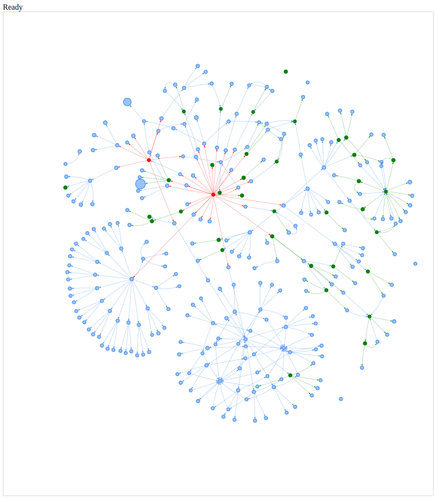

Espruino Memory Viewer
=======================

This tool allows you to connect to an [Espruino](https://www.espruino.com/)/Bangle.js device via Web Bluetooth
and then display the contents of RAM as a Network.

It's a good way to look into your code and see if there's anything obviously using memory that shouldn't be.

To use it:

* [Open this link](https://espruino.github.io/EspruinoMemView/vis.html)
* Click `Connect`
* Wait...
* Then click and drag and use the mousewheel to zoom
* Clicking on a node will show you information about that node at the top, including a calculated `path`
which may be able to show you where the variable is defined.

* **RED** are `global` and `hidden` objects in Espruino
* **GREEN** are functions
* **GREY** links are added between array/object elements to enforce ordering

## Diff

After initially connecting, you might want to do something on your device that is causing memory usage
to increase, and then click the `Diff` button. This will scan all memory again and will make all variables
that were previously allocated grey (note that if variables have moved around, it is possible that new
variables will be turned grey instead).

## Garbage Collection

Before requesting the variables, EspruinoMemView triggers a garbage collect so that variables
that are not needed are removed (which helps remove distracting information).

However, when doing `Diff` you can uncheck the `GC?` checkbox which will ensure
a garbage collect isn't done when the diff is created. This will allow you to see
new 'garbage' (which will be noticeable by the way it's not connected to anything else).

**Why is there garbage?** Espruino normally frees any 'unreferenced' variables, but if a datastructure
is self-referential (for example `a={}; a.b=a;`) then Espruino won't immediately detect this and will
not free it until the available memory runs low and a GC pass is performed. You can detect self-referential
datastructures by looking at the net for 'loops' of reference (eg a loop where the arrows all point in the same direction).

If you can find where the loop is, you may be able to modify your code such that the
looping reference is removed before the datastructure becomes unused, which will then
ensure that Garbage Collection has to happen less frequently.

